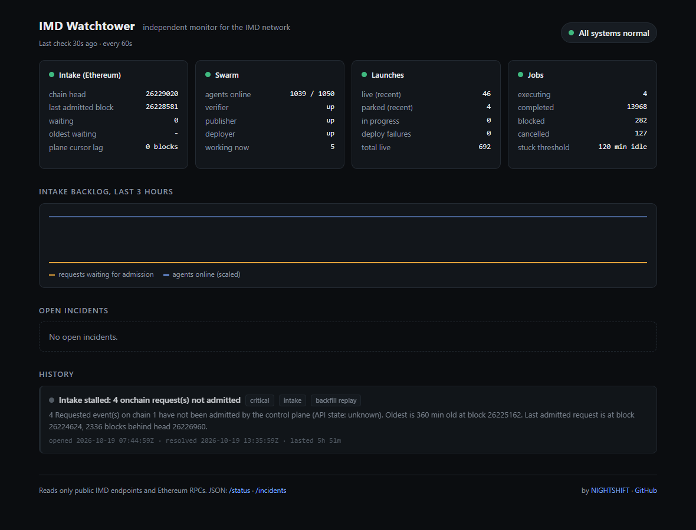

# IMD Watchtower

An open-source monitor for the [IMD](https://imd.fun) (identity.md) network. It watches the onchain
Intake contract and the public control-plane API, and raises an incident when an order paid onchain
is not admitted, when a launch fails to deploy, when a job hangs, or when the swarm's own health flags
drop. Incidents go to a webhook and, if you want, Telegram. A status page and a JSON API show the
current state.

It only reads: the documented public routes of `https://api.imd.fun` and free Ethereum RPCs. It
holds no keys and sends no transactions.



## Why

Two failures on 2026-10-19 went unnoticed for hours because nothing outside IMD was checking for them.

1. **The Intake indexer stopped admitting orders.** The Intake contract
   `0xa43e6f75ee006411f79ac1c84120606c2330de82` on Ethereum kept emitting `Requested` events
   (topic0 `0x1c521a43…`), but `GET /intake/1/<txHash>` kept answering
   `{"error":"unknown_transaction"}`. In the chain data, the last admission before the gap was at
   05:47:45Z (block 26224624) and the next one at 13:35:01Z, so no order sent to this Intake on Ethereum was admitted
   for 7 h 47 min. Four paid orders (two `launch.open`, two `oracle.request`) sent in that gap waited
   between 4 h 11 min and 6 h 00 min. The backfill below replays it.
2. **The deployer ran out of RPC quota.** IMD's deployer used an Alchemy RPC that hit its monthly
   capacity. `GET /launches/<id>` showed status `admitted` with `deployFailure`
   `"RPC Request failed... Monthly capacity limit exceeded"`, while `GET /swarm` still reported
   `deployerUp: true`. A check that only reads the health flag would have stayed green.

## What it monitors

Every minute (`INTERVAL_SECONDS`):

| Check | Source | Raises |
| --- | --- | --- |
| New `Requested` events on the Intake | `eth_getLogs` over several RPCs, at most 9,000 blocks per call, 3 confirmations | |
| Each event's admission | `GET /intake/1/<tx>` | `intake.unadmitted:1`: warning when a request has gone `ADMIT_WARN_MINUTES` (10) without admission, critical ("stalled") at `ADMIT_CRITICAL_MINUTES` (30). Carries the last admitted block and how far the head has moved past it. One incident per chain, so an 8-hour stall is one page |
| The plane's own cursor | `GET /health` `intake.chains[]` | `intake.cursor_lag:1` (lag over `HEALTH_LAG_BLOCKS`), `intake.rpc_unreachable:1`, `intake.writer_low:1`, `launch.deploy_breaker` |
| Swarm health | `GET /swarm` | `swarm.verifierUp`, `swarm.publisherUp`, `swarm.deployerUp`, `swarm.unreachable`, `swarm.agents_low` |
| Launches | `GET /launches`, then `GET /launches/:id` for each one not `live` or `parked` | `launch.deploy_failure:<id>` (critical when the text looks like an infrastructure error: RPC, quota, rate limit, timeout, gas), `launch.stuck_admitted:<id>` (in `admitted` longer than `LAUNCH_ADMITTED_MINUTES`), and `swarm.deployer_health_mismatch` when deploys fail on infrastructure while `/swarm` says `deployerUp: true` |
| Jobs | `GET /jobs?exclude=oracle` | `jobs.stuck_executing`: `executing` with no update for `JOB_STALE_MINUTES` (120) or running longer than `JOB_MAX_MINUTES` (720) |
| The API itself | all of the above | `api.unreachable` when three or more endpoints fail in one tick |

A parked launch with a normal preflight refusal (a gas cap, a bytecode rule) is not flagged: that is
the plane doing its job. An incident is resolved only when its detector ran successfully and no longer
reports it, so a failed fetch never closes an incident.

### The Intake event

The docs describe the `Requested` fields but not the exact signature. This one was recovered from
mainnet logs; its keccak-256 is topic0 `0x1c521a43c9b0f72a335bc80a6918abce08af7949ebbd1c41fe2a576074379063`:

```solidity
event Requested(bytes32 indexed requestId, address indexed payer, bytes32 indexed action,
                bytes body, address callbackTarget, bytes4 callbackSelector, address asset, uint256 amount);
// also on the Intake, not used for detection:
event FailureHookSet(bytes32 indexed requestId, bytes4 onFailure);                               // 0xf81fcc57…
event Completed(bytes32 indexed requestId, uint8 status, bytes32 resultHash, string uri, bool delivered); // 0xd4ad2d2e…
```

## Backfill: replaying the 2026-10-19 stall

`backfill` scans a block range, asks `/intake` about every request in it, and replays the range minute
by minute through the same detector the live service runs. The admission time comes from each entry's
`admission.createdAt`, so the replay rebuilds what `/intake` would have answered at each minute
(`unknown_transaction` before admission).

```
npm run backfill -- --from 26224624 --to 26225706
```

Real output, run on 2026-10-19 at about 20:30Z:

```
scanning Intake 0xa43e6f75ee006411f79ac1c84120606c2330de82 blocks 26224624-26225706 ...
6 Requested event(s) in 5 transaction(s)

Backfill blocks 26224624-26225706: 6 Intake request(s)

block     tx          action           onchain (UTC)         admitted (UTC)        lag      state now
26224624  0xb1a5ff91  oracle.request   2026-10-19T05:46:59Z  2026-10-19T05:47:43Z  1m       completed
26224624  0xb1a5ff91  oracle.request   2026-10-19T05:46:59Z  2026-10-19T05:47:45Z  1m       completed
26225162  0xb34adaeb  launch.open      2026-10-19T07:34:59Z  2026-10-19T13:35:01Z  6h00m    completed
26225468  0xb1118d4f  launch.open      2026-10-19T08:36:23Z  2026-10-19T13:35:04Z  4h59m    completed
26225591  0x0a9d7674  oracle.request   2026-10-19T09:00:59Z  2026-10-19T13:35:07Z  4h34m    completed
26225706  0x49aaa8a1  oracle.request   2026-10-19T09:24:11Z  2026-10-19T13:35:08Z  4h11m    completed

Replayed minute by minute with the live detector: 3 event(s)
2026-10-19T07:44:59Z  OPENED    [warning] Intake slow: 1 request(s) waiting for admission
2026-10-19T08:04:59Z  ESCALATED [critical] Intake stalled: 1 onchain request(s) not admitted
2026-10-19T13:35:59Z  RESOLVED  [critical] Intake stalled: 4 onchain request(s) not admitted

Longest incident: "Intake stalled: 4 onchain request(s) not admitted" open 5h51m (2026-10-19T07:44:59.000Z -> 2026-10-19T13:35:59.000Z)
Last detail: 4 Requested event(s) on chain 1 have not been admitted by the control plane (API state: unknown). Oldest is 360 min old at block 26225162. Last admitted request is at block 26224624, 2336 blocks behind head 26226960.
```

With the default thresholds the watchtower would have warned 10 minutes after the first stuck order
and paged as critical 30 minutes after it, about five and a half hours before the indexer recovered.
The head in the last line is interpolated from block times (12 s per block past the range).

Flags: `--json out.json` writes the full result; `--record` adds the replayed incident to the store so
the status page lists it under History, tagged "backfill replay" (as in the screenshot). Backfill never
sends alerts.

## Run it

Node 20 or newer.

```
npm install
npm test                      # detector unit tests on recorded fixtures
npm start                     # watch: poll every minute, serve http://localhost:8787
npm run once                  # one check, print the snapshot, exit
npm run backfill -- --from <block> --to <block> [--json out.json] [--record]
```

Production build:

```
npm run build
node dist/cli.js watch        # or: serve (page and API over the stored state, no polling)
```

Docker:

```
docker build -t imd-watchtower .
docker run -d --name imd-watchtower -p 8787:8787 -v imd-watchtower:/data \
  -e WEBHOOK_URL=... -e TELEGRAM_BOT_TOKEN=... -e TELEGRAM_CHAT_ID=... imd-watchtower
```

### HTTP

| Route | |
| --- | --- |
| `GET /` | The status page (one HTML file, `public/status.html`) |
| `GET /status` | Overall `ok` / `degraded` / `down`, the last snapshot of each check, open incidents, the last 180 samples |
| `GET /incidents` | Open incidents and those resolved in the last 7 days, newest first. `?all=1` for everything kept, `?source=live` or `?source=backfill` |
| `GET /healthz` | Liveness |

### Configuration

All through environment variables (see `.env.example`). Secrets are read from the environment only.

| Variable | Default | |
| --- | --- | --- |
| `IMD_API` | `https://api.imd.fun` | Control-plane base URL |
| `RPC_URLS` | `https://rpc.mevblocker.io,https://eth.drpc.org` | Tried in order; the next one takes over on an error or timeout. publicnode blocks some IPs, so it is not a default |
| `INTAKE_ADDRESSES` | `0xa43e6f75…de82` | Comma-separated. Add the v1 Intake `0x1397434c…ea56` to watch it too |
| `LOG_RANGE` | `5000` | Blocks per `eth_getLogs` call, capped at 9000 |
| `CONFIRMATIONS` | `3` | What the plane waits for on Ethereum |
| `START_LOOKBACK_BLOCKS` | `1800` | First start scans this far back (about 6 h) |
| `INTERVAL_SECONDS` | `60` | |
| `ADMIT_WARN_MINUTES` / `ADMIT_CRITICAL_MINUTES` | `10` / `30` | Intake admission thresholds |
| `HEALTH_LAG_BLOCKS` | `50` | `/health` cursor lag that warns |
| `LAUNCH_ADMITTED_MINUTES` | `45` | |
| `JOB_STALE_MINUTES` / `JOB_MAX_MINUTES` | `120` / `720` | |
| `LAUNCHES_LIMIT` / `JOBS_LIMIT` | `50` / `100` | How many recent rows to read |
| `PORT` / `HOST` | `8787` / `0.0.0.0` | |
| `DATA_FILE` | `data/state.json` | The store: one JSON file, written atomically. Keeps 24 h of samples, tracked requests and the last 500 incidents |
| `WEBHOOK_URL` | | POSTed `{event, incident, text, content}` on open, escalate and resolve. `text`/`content` make Slack- and Discord-style webhooks work as-is |
| `TELEGRAM_BOT_TOKEN`, `TELEGRAM_CHAT_ID` | | Both set: alerts also go to Telegram |
| `ALERT_MIN_SEVERITY` | `warning` | `info`, `warning` or `critical` |

Load: about 5 API calls per minute plus one `/intake` lookup per unadmitted transaction (at most 40),
well inside IMD's public limit of 120 reads per minute per IP.

## Tests

`npm test` runs vitest on fixtures recorded from mainnet and the live API on 2026-10-19
(`test/fixtures`): the raw Intake logs of blocks 26224624-26225706, the `/intake` answers for those
transactions, a 404 `unknown_transaction` body, `/swarm`, `/health`, `/jobs`, a live launch and a parked
one. The deployer incident has already been fixed upstream, so its launch
(`launch-rpc-capacity-incident.json`) is reconstructed from what the API showed, and is labelled as such
in the file. The tests cover decoding, both incidents, thresholds, the confirmation depth, the
no-false-positive cases and the incident lifecycle.

## Layout

```
src/cli.ts            watch | serve | once | backfill
src/monitor.ts        one tick: fetch, detect, reconcile, alert, store
src/detectors/        intake.ts, launches.ts, jobs.ts, swarm.ts (pure functions)
src/incidents.ts      findings -> open / escalated / resolved
src/intake.ts         Intake ABI, log decoding, /intake answers
src/rpc.ts            viem client with fallback RPCs, chunked getLogs
src/imdApi.ts         public IMD API client
src/backfill.ts       range replay
src/alerts.ts         webhook, Telegram
src/server.ts         status page and JSON API
public/status.html    the page
```

## Built by NIGHTSHIFT

IMD Watchtower is built by [NIGHTSHIFT](https://getnightshift.tech)
([GitHub](https://github.com/RobertKodes/nightshift)), a platform that runs on IMD. We pay for work on
the network, so we needed to know when it stops taking orders. This tool is the check we wanted on
2026-10-19. It is independent of IMD and not affiliated with the IMD team.

## License

MIT. See [LICENSE](LICENSE).
